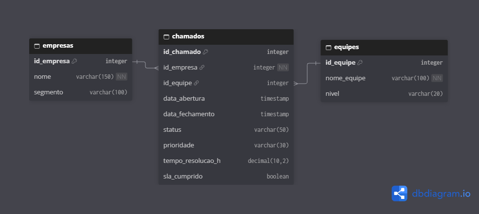
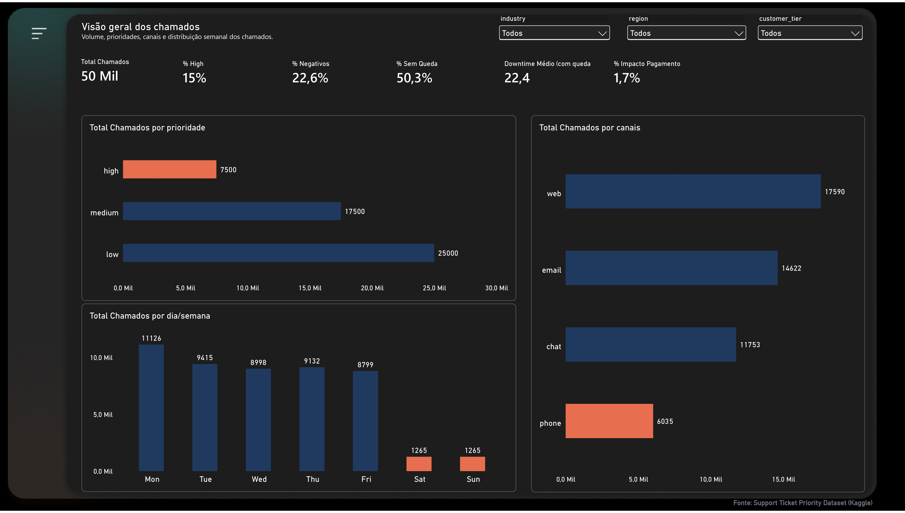
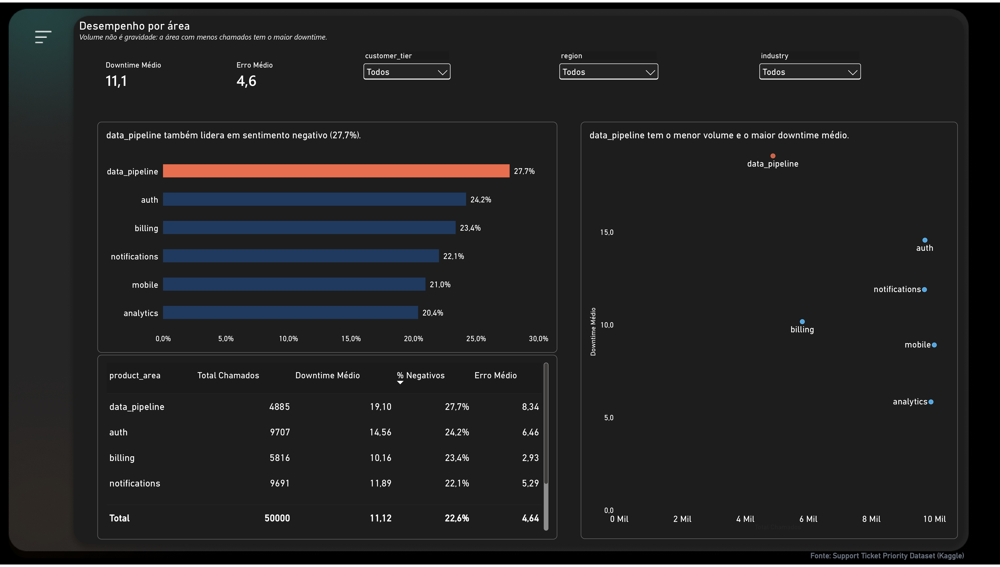
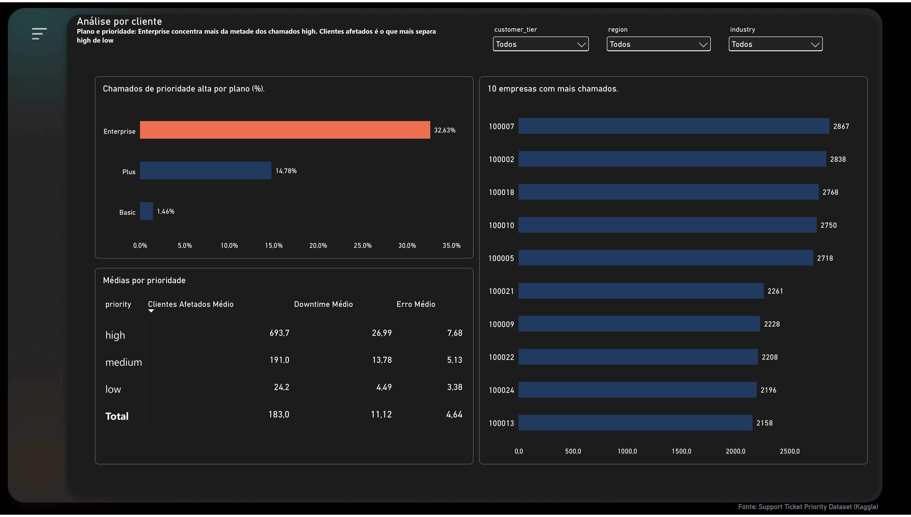

# Análise de Chamados de Suporte e SLA

Projeto de portfólio em análise de dados que investiga chamados de suporte, prioridades, indisponibilidade e indicadores operacionais. A análise combina consultas SQL e um dashboard no Power BI para transformar registros de atendimento em informações úteis para investigação e tomada de decisão.

> **Nota sobre os dados:** o conjunto utilizado é destinado a estudo e demonstração. Os registros não representam operações reais de uma empresa.

## Objetivos

- Praticar SQL por meio de perguntas de negócio, agregações e verificações de qualidade dos dados.
- Investigar como prioridade, área do produto, plano do cliente e indisponibilidade se relacionam.
- Construir indicadores e comunicar resultados com Power BI.
- Documentar interpretações, limitações e cuidados para não confundir correlação com causalidade.

## Tecnologias

- **SQLite / SQL:** consultas, agrupamentos, subconsultas, `CASE WHEN`, filtros com `HAVING` e verificações de qualidade.
- **Power BI:** visualização dos indicadores e exploração dos resultados.
- **DAX:** medidas utilizadas no dashboard.
- **CSV:** arquivo de origem dos dados.

## Estrutura do repositório

```text
analise-chamados-sla/
├── README.md
├── sql/
│   └── analise-chamados-sla.sql
├── dashboard/
│   ├── Analise-de-Chamados-SLA.pbix
│   └── Chamados_de_suporte_SLA.pdf
└── data/
    ├── support_tickets.csv
    └── suporte.db
├── docs/
│   ├── README.md
│   ├── database.dbml
│   └── diagrama-erd.png
```

## Modelagem de dados

O diagrama abaixo documenta uma **proposta de estrutura relacional** para os chamados, com entidades de empresas, equipes e chamados, incluindo chaves primárias e relacionamentos. Ele é um modelo didático e não deve ser confundido com a estrutura física já implementada no banco SQLite do projeto.



- [Documentação da modelagem](docs/README.md)
- [Código-fonte do diagrama em DBML](docs/database.dbml)

## Arquivos

| Arquivo | Descrição |
|---|---|
| [Consultas SQL](sql/analise-chamados-sla.sql) | Perguntas de negócio e consultas exploratórias organizadas por níveis de dificuldade. |
| [Dashboard Power BI](dashboard/Analise-de-Chamados-SLA.pbix) | Arquivo Power BI Desktop (.pbix). |
| [Relatório em PDF](dashboard/Chamados_de_suporte_SLA.pdf) | Versão em PDF disponível para visualização no navegador. |
| [Dados CSV](data/support_tickets.csv) | Conjunto de dados usado no projeto. |
| [Banco SQLite](data/suporte.db) | Banco de dados local preparado para consultar os registros. |

O GitHub não renderiza arquivos `.pbix` como dashboards interativos na página do repositório; baixe o arquivo e abra-o no Power BI Desktop. O repositório também disponibiliza uma versão em PDF para consulta sem o Power BI Desktop.

## Dashboard Power BI — visualização das páginas

O relatório apresenta indicadores operacionais de chamados de suporte e análises exploratórias. As três primeiras capturas estão disponíveis diretamente abaixo; a quarta página, **Dicionário de Indicadores**, pode ser consultada no [PDF completo](dashboard/Chamados_de_suporte_SLA.pdf). Para usar filtros e interações, abra o [arquivo original do Power BI](dashboard/Analise-de-Chamados-SLA.pbix) no Power BI Desktop.

### Página 1 — Visão geral dos chamados



**Objetivo:** oferecer uma leitura inicial do volume de chamados e dos indicadores operacionais, ajudando a identificar pontos que merecem investigação.

### Página 2 — Análise operacional



**Objetivo:** aprofundar a comparação de indicadores entre grupos e apoiar a interpretação de diferenças observadas na base.

### Página 3 — Exploração dos indicadores



**Objetivo:** complementar a análise com visualizações que permitem examinar padrões e possíveis associações, sem inferir causalidade.

### Página 4 — Dicionário de Indicadores

**Objetivo:** documentar as definições, fórmulas DAX, unidades de medida e cuidados de leitura dos indicadores utilizados no painel. Essa página também inclui orientações de navegação e a origem dos dados.

**Exemplos de cuidados documentados:** o downtime médio de todos os chamados difere da média apenas dos chamados com queda; valores extremos podem distorcer médias; indicadores percentuais dependem dos filtros e dos denominadores utilizados.

[Abrir a quarta página no relatório em PDF](dashboard/Chamados_de_suporte_SLA.pdf)

> **Nota:** as imagens são capturas estáticas. Os títulos descritivos acima servem para orientar a leitura do portfólio; a referência definitiva para os nomes e conteúdos de cada aba é o arquivo Power BI. A captura da quarta página ainda precisa ser incorporada como imagem ao repositório.

## Perguntas investigadas

As consultas exploram, entre outros temas:

- Como os chamados se distribuem por prioridade, área do produto, canal e dia da semana?
- Quais áreas apresentam maior indisponibilidade média e maior proporção de sentimento negativo?
- Como a proporção de chamados de prioridade alta varia entre os planos de cliente?
- A presença de runbook está associada a menor downtime? A análise também compara as áreas para contextualizar essa relação.
- Existem identificadores duplicados, valores ausentes ou valores extremos que merecem investigação?
- Quais características dos chamados diferem entre os níveis de prioridade?

## Principais achados

Os resultados observados nesta versão da análise incluem:

- **Área `data_pipeline`:** menor volume de chamados entre as áreas analisadas, mas maior downtime médio (19,1 minutos), taxa de erro (8,3%) e proporção de sentimento negativo (27,7%).
- **Plano do cliente:** a proporção de chamados de prioridade alta é de 32,6% no plano Enterprise e 1,5% no Basic.
- **Runbook:** a comparação agregada, isoladamente, não demonstra que a presença de runbook reduz o downtime. A composição por área precisa ser considerada antes de tirar conclusões.
- **Downtime:** aproximadamente metade dos chamados não registra indisponibilidade. Por isso, a média considerando todos os chamados (11,1 minutos) é inferior à média apenas dos chamados com downtime (22,4 minutos).
- **Distribuição por empresa:** o volume de chamados é relativamente equilibrado entre as 25 empresas presentes no conjunto.

Esses achados descrevem os dados analisados; não demonstram, por si só, relações causais nem garantem que o mesmo padrão ocorreria em uma operação real.

## Como explorar

1. Comece pelas perguntas e consultas no arquivo SQL.
2. Abra o arquivo `.pbix` no Power BI Desktop para explorar as páginas, os filtros e os indicadores.
3. Compare os resultados das consultas com os indicadores do dashboard.
4. Considere as definições e limitações de cada métrica antes de interpretar as diferenças entre grupos.

## Escopo e limitações

- Os dados são sintéticos e servem para demonstração técnica.
- Resultados agregados podem variar quando filtros diferentes são aplicados no dashboard.
- Uma associação observada entre variáveis não prova causalidade.
- O downtime igual a zero deve ser interpretado com cuidado: ele pode representar chamados sem indisponibilidade registrada, e não necessariamente ausência de impacto em todos os sentidos.

---

Projeto desenvolvido para praticar SQL, análise exploratória e comunicação de dados com Power BI.
