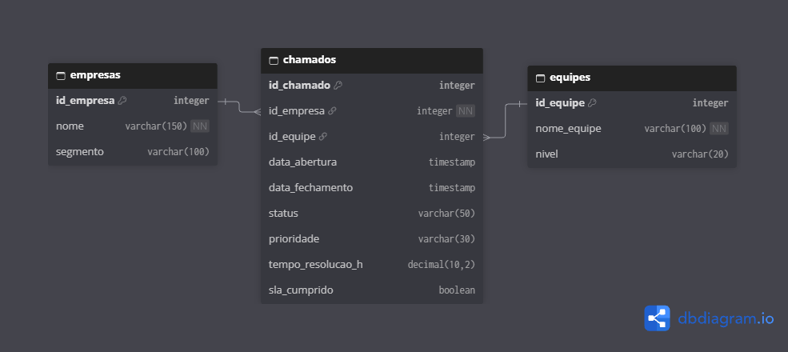

# Modelagem de Dados

A estrutura dos dados do projeto foi documentada
utilizando DBML e dbdiagram.io.

O diagrama apresenta as entidades, seus atributos,
chaves primárias e relacionamentos.

## Diagrama Entidade-Relacionamento (DER)

## Estrutura DBML

[Consultar modelo DBML](./database.dbml)
